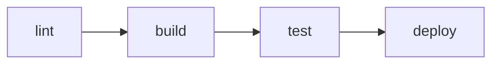
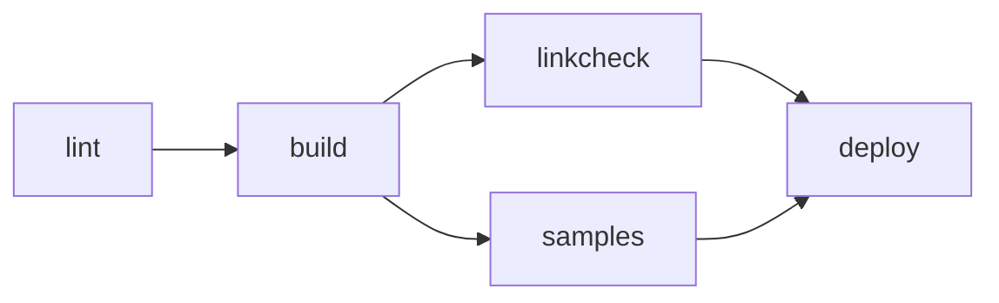

# Diagrams as code

`supporting` · difficulty 2 · 3h

> Keeping architecture and pipeline diagrams in the repository as text, reviewed like code and checked against the system they describe.

**Prerequisites:** [Docs-as-code](docs-as-code.md)

## What it is

Writing diagrams as text, in a language such as Mermaid or PlantUML, that a
build turns into an image. The diagram lives in the same repository as the
page, changes in the same pull request, and shows up in a diff.

The format is the easy half. The harder half is that a diagram is a copy of a
system, and copies drift. Text makes it possible to check a diagram against
the thing it describes, or to generate it from that thing, which a picture
pasted from a drawing tool never allows.

## How this applies to your role

Because diagrams are the part of the documentation that goes wrong most
quietly. A wrong sentence gets noticed and fixed; a wrong box-and-arrow picture
gets trusted, because readers look at diagrams to orient themselves and rarely
read them closely.

On a Tuesday it looks like this. A new engineer asks why their change waited
for a link check before deploying, when the pipeline diagram on the
contributing page shows lint, build, test, deploy. The diagram was right a
year ago. Since then the test job was split in two and a link check was added,
and nobody updated a PNG that only one person could edit. It was not anybody's
job, and nothing could have caught it.

As text, the same diagram is three lines in the page's source, reviewed with
the change that made it wrong, and checkable in CI against the workflow file
it describes. It also gains something a PNG rarely has: a title and
description that a screen reader can announce, which is the
[accessibility](accessibility.md) requirement most diagrams quietly fail.

## The golden path

Check a hand-drawn pipeline diagram against the CI workflow it claims to show,
find the drift and the missing text alternative, then generate the diagram
from the workflow so it cannot drift again. About twenty-five minutes.

The check is committed as `drills/diagram_drift.py` (it needs `pyyaml`), which
holds both files below and a test that keeps them identical to this page.

**Step 1: a workflow, and the page that describes it**

````bash
mkdir -p diagram-drill && cd diagram-drill
pip install pyyaml
cat > workflow.yml <<'DATA'
name: docs
on: [pull_request]
jobs:
  lint:
    runs-on: ubuntu-latest
    steps: [{run: vale docs}]
  build:
    needs: lint
    runs-on: ubuntu-latest
    steps: [{run: mkdocs build --strict}]
  linkcheck:
    needs: build
    runs-on: ubuntu-latest
    steps: [{run: python3 check_links.py site}]
  samples:
    needs: build
    runs-on: ubuntu-latest
    steps: [{run: pytest docs}]
  deploy:
    needs: [linkcheck, samples]
    runs-on: ubuntu-latest
    steps: [{run: mkdocs gh-deploy}]
DATA
cat > pipeline.md <<'DATA'
# How a docs change ships

Every pull request runs this pipeline:


DATA
curl -sO https://raw.githubusercontent.com/johnallred/fieldguide/main/drills/diagram_drift.py
````

**Step 2: check the diagram against the workflow**

```bash
python3 diagram_drift.py workflow.yml pipeline.md
```

```
== pipeline.md
DRIFT  edge build -> test: in the diagram, not in the workflow
DRIFT  edge test -> deploy: in the diagram, not in the workflow
DRIFT  edge build -> linkcheck: in the workflow, not in the diagram
DRIFT  edge build -> samples: in the workflow, not in the diagram
DRIFT  edge linkcheck -> deploy: in the workflow, not in the diagram
DRIFT  edge samples -> deploy: in the workflow, not in the diagram
DRIFT  node test: no job of that name
A11Y   mermaid block 1 has no accTitle
A11Y   mermaid block 1 has no accDescr
9 finding(s)
```

Seven findings are drift. The diagram still shows a single `test` job that no
longer exists, and it misses the link check and sample jobs that run in
parallel after the build. The other two are accessibility: the diagram has no
title or description, so a screen reader announces it as a diagram and
nothing more.

**Step 3: generate the diagram from the workflow**

```bash
python3 diagram_drift.py --generate workflow.yml > pipeline.md
cat pipeline.md
python3 diagram_drift.py workflow.yml pipeline.md
```

````
# How a docs change ships

Every pull request runs this pipeline:



== pipeline.md
0 finding(s)
````

The description is generated from the same edges as the arrows, so the text
alternative cannot drift from the picture either. Run the generator in the
docs build, or run the check in CI, and the next added job fails the pull
request that added it instead of misleading a new engineer a year later.

**Step 4: render it**

Rendering is not part of this drill, because it needs a JavaScript runtime.
GitHub renders a `mermaid` code block in Markdown files, issues and pull
requests directly. Material for MkDocs renders one after a `custom_fences`
entry for `mermaid` under `pymdownx.superfences`. To produce an image file
instead, `mmdc -i pipeline.mmd -o pipeline.svg` with the Mermaid CLI.

**What you built.** A diagram check that found seven drifted edges and nodes
and two missing text alternatives, and a generated diagram, with a generated
description, that matches its source by construction.

## Reference

### Choosing a language

| Tool | Strength | Cost |
|---|---|---|
| Mermaid | Renders on GitHub and in Material for MkDocs with no build step | Layout control is limited; large diagrams get messy |
| PlantUML | Broad diagram types, full UML, mature layout through Graphviz | Needs a renderer: Graphviz or its built-in Java port |
| A drawing tool's export | Any layout you can imagine | Not diffable, not checkable, edited by whoever owns the file |

Mermaid is the default for diagrams that live beside documentation, because
the platforms readers already use render it.

### Where diagrams render

| Surface | How |
|---|---|
| GitHub Markdown, issues, pull requests | A `mermaid` fenced block; no configuration |
| Material for MkDocs | `pymdownx.superfences` with a `mermaid` custom fence |
| Anywhere else | Pre-render to SVG with `mmdc` and commit or build the image |

### Accessibility in Mermaid

| Keyword | Produces |
|---|---|
| `accTitle: text` | A `<title>` in the SVG, referenced by `aria-labelledby` |
| `accDescr: text` | A `<desc>` in the SVG, referenced by `aria-describedby` |
| `accDescr { ... }` | The same, over several lines |

Mermaid also sets `aria-roledescription` to the diagram type on its own, which
tells a screen reader what kind of picture it is and nothing about what it
shows.

### What to check in CI

| Check | Catches |
|---|---|
| Every diagram has a title and a description | Diagrams invisible to screen readers |
| Diagrams of a system match that system | Stale pipelines, removed services, renamed components |
| Diagrams render without error | Syntax mistakes that show readers raw text |
| Generated diagrams are up to date | Someone editing the output instead of the source |

### Sources

Opened and checked on 2026-11-23:
[Mermaid accessibility options](https://mermaid.js.org/config/accessibility.html),
[GitHub: creating diagrams](https://docs.github.com/en/get-started/writing-on-github/working-with-advanced-formatting/creating-diagrams),
[Material for MkDocs: diagrams](https://squidfunk.github.io/mkdocs-material/reference/diagrams/),
[Mermaid CLI](https://github.com/mermaid-js/mermaid-cli),
[PlantUML](https://plantuml.com/).

## Explaining it to your team

**How to explain it.** Lead with drift, not with tooling. "Our pipeline diagram
shows four jobs and the pipeline has five, in a different shape. As a picture
nobody could check it; as text, a twenty-line script compares it with the
workflow file on every pull request, and it can generate the diagram so there
is nothing to keep in sync."

**The follow-up is usually "the text diagrams look worse".** Often true. Mermaid
gives up layout control in exchange for being reviewable and checkable. For a
diagram that changes when the system changes, that trade is worth it. For a
one-off conceptual illustration that will never be wrong, a drawn image with
good alternative text is fine.

**The tradeoff to name.** Generating diagrams from a system only works where
the system has a machine-readable shape: a workflow, a service registry, a
schema. Architecture diagrams that show intent rather than configuration
cannot be generated, only reviewed, so for those the gain is diffability and
accessibility, not correctness.

**One sharper point.** A diagram's text alternative is usually written once
and never updated, so it drifts even faster than the picture. Generating the
description from the same data as the arrows is the only arrangement where the
screen-reader version and the visual version are guaranteed to say the same
thing.

## Putting it into practice

**The work product.** Every diagram in one documentation set converted to text,
each with a title and description, and the ones that describe a system checked
against it in CI.

**Three things to do, in order:**

1. Run the golden path, then list every diagram image in a docs set you
   maintain. Expect most of them to have no meaningful alternative text.
2. Convert the one that describes something with a config file (a pipeline, a
   deployment, a schema) and add a drift check for it.
3. Add a CI check that fails any `mermaid` block without `accTitle` and
   `accDescr`.

**How to tell it is working.** The drill above runs in this guide's test suite
and its output is the output quoted here. This guide also does the end state
for real: [How this guide ships](../explanation/pipeline.md) is its own
pipeline, drawn as a Mermaid flowchart that `fieldguide build` generates from
`.github/workflows/gates.yml`, rendered on the published site, with an
accessible title, a description and a table carrying the same information. CI
runs `fieldguide build --check`, so adding a job to the workflow fails the
change until the diagram is regenerated. In your own docs, the sign is that a
change to a pipeline or a service fails a pull request until its diagram
changes too.

## Related

- [Docs-as-code](docs-as-code.md), the workflow diagrams join
- [Code-sample validation](code-sample-validation.md), the same drift problem for code
- [Accessibility checks](accessibility.md), where text alternatives are checked
- [GitHub Actions for docs](github-actions.md), the workflow the drill reads
- [Single-sourcing and content reuse](single-sourcing.md), generating the picture from the source of truth
