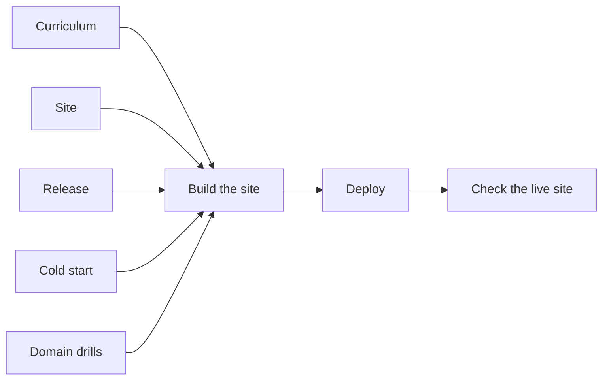

# How this guide ships

Every change to this guide runs the jobs below, and the site is published only
when every gate has passed. The diagram is generated by `fieldguide build` from
`.github/workflows/gates.yml`, and CI fails if the workflow changes without it,
which is the end state the [diagrams as code](../concepts/diagrams-as-code.md)
page works towards.

## Each job

Five jobs run in parallel on every change: Curriculum, Site, Release, Cold start and Domain drills. Build the site runs after Curriculum, Site, Release, Cold start and Domain drills. Deploy runs after Build the site. Check the live site runs after Deploy.

| Job | Runs after | Named steps |
|---|---|---|
| Curriculum | the change | The registry and the docs tree agree; Generated pages are up to date; Every test passes |
| Site | the change | The site builds with warnings as errors; Every fenced sample renders as code; The built site passes the crawl audit; The built site passes the accessibility checks |
| Release | the change | The release workflow passes every step |
| Cold start | the change | The README quick start runs from an empty environment |
| Domain drills | the change | The domain drills run on their real dependencies; The build-time drill still produces its table |
| Build the site | Curriculum, Site, Release, Cold start, Domain drills | none |
| Deploy | Build the site | none |
| Check the live site | Deploy | none |
